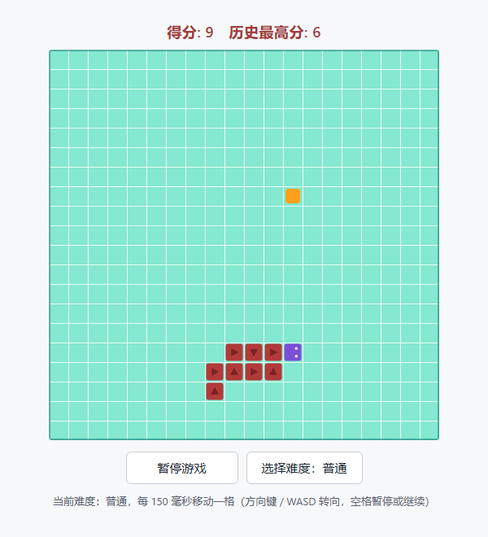

# Snake-game Skill

[English](README.md) · [简体中文](README.zh-CN.md) · [Français](README.fr.md) · **Русский** · [日本語](README.ja.md)

Открытый Agent Skill, благодаря которому ИИ выдаёт вам игру «змейка», **в которую можно играть сразу после открытия файла**.



## Играть сразу
**С любого телефона или компьютера — просто откройте эту ссылку:**

> 🎮 **https://wohui-netizen.github.io/wohui-Snake-game/skills/snake-game/assets/snake-game.html**
>
> Сайт документации (щелчок переключает язык на месте): https://wohui-netizen.github.io/wohui-Snake-game/

Затем нажмите `Start Game`. На телефоне смахивайте по полю, чтобы поворачивать, и касайтесь для паузы.


Ничего устанавливать не нужно — ни ИИ, ни сборки: игра уже лежит в этом репозитории **одним файлом**.

1. Откройте **[`skills/snake-game/assets/snake-game.html`](skills/snake-game/assets/snake-game.html)** и нажмите **Download raw file** (или клонируйте репозиторий).
2. **Дважды щёлкните скачанный файл** — он откроется в браузере и работает без интернета.
3. Нажмите **`Start Game`** (в русском интерфейсе — «Начать игру»):

| Клавиши / элемент | Действие |
| --- | --- |
| `←` `↑` `→` `↓` или `W` `A` `S` `D` | управлять змейкой (стрелка также начинает игру) |
| `Пробел` | пауза / продолжить |
| кнопка `Difficulty: Normal` | перебирает Легко → Обычно → Сложно → Ад (правее — быстрее) |
| строка языков под кнопками | переключает интерфейс: English, 简体中文, Français, Русский, 日本語 |

Съедайте оранжевые квадраты, не врезайтесь в стены и в себя, попробуйте заполнить всё поле. Рекорд сохраняется.

Хотите по ссылке? Поднимите локальный сервер и откройте страницу:

```bash
cd skills/snake-game/assets
python -m http.server 8000
# затем откройте http://localhost:8000/snake-game.html
```


## 1. Какую задачу это решает?

Написать «змейку», которая «просто работает по двойному щелчку», — значит одновременно уладить длинный список мелких деталей: цикл по времени и скорости уровней сложности, три разных финала (удар в стену / удар в себя / заполнение поля), клавиши направления, которые теряют ввод при быстром нажатии, змейка, телепортирующаяся в стену после переключения вкладки и возвращения, сохранение рекорда, сенсорное управление и внешние ресурсы, из-за которых страница ломается, стоит оказаться офлайн. Попросите ИИ сгенерировать всё с нуля — и результат обычно выглядит играбельным, скрывая настоящие ошибки.

Этот проект фиксирует **полную реализацию, проверенную автоматическими тестами**, в виде ресурса навыка и переносит спецификацию поставки вместе с чек-листом приёмки в `SKILL.md`: вместо написания с нуля ИИ копирует базовую версию, меняет только то, что просил пользователь, и проверяет себя по пунктам перед выдачей результата.

- **Для пользователей**: ничего устанавливать и собирать не нужно — вы получаете один `index.html`, который играется по двойному щелчку. Кастомизация затрагивает несколько документированных точек, а всё остальное не ломается.
- **Для ИИ**: критерий «готово» — пользователь может открыть страницу и действительно играть; спецификация, условия окончания и проверки записаны в навык, а не придумываются на ходу.
- **Не для**: веб-скрапинга, работы с PDF или Anki; а также всего, что требует бэкенда, сетевой игры или таблицы лидеров (навык прямо об этом предупреждает; для такого нужен отдельный проект).

## 2. Основные возможности

### 2.1 Возможности навыка

- **Жёсткая спецификация поставки**: строка счёта сверху, сеточное поле посередине, две кнопки снизу, внешний вид змейки и еды, сложность и скорость, условия окончания, управление и сообщения о состоянии — всё записано в таблицу спецификации в `SKILL.md`.
- **Процесс из пяти шагов**: выбрать путь вывода → скопировать `assets/snake-game.html` как основу → изменить только то, что назвал пользователь → пройти чек-лист приёмки → сообщить путь, способ открытия и список изменений.
- **Чек-лист приёмки**: три группы, проверяемые по пунктам, — структура (один файл, никаких внешних ссылок, чистая консоль), поведение (поедание, три финала, повороты, пауза, рекорд, узкие экраны) и визуальная часть.
- **Пять документированных точек изменений**: `COLORS`, `DIFFICULTIES`, `MESSAGES` (все тексты интерфейса и переводы), `new SnakeGame(canvas, { cols, rows, cell, difficultyIndex })` и слой ввода (`KEY_DIRECTIONS` и обработчик `keydown`).
- **Границы применимости**: никакого скрапинга / PDF / Anki; никаких фреймворков, сборщиков и бэкенда.

### 2.2 Игра, которую вы получаете (измерено на базовой версии)

| Область | Возможность |
| --- | --- |
| Форма поставки | Один самодостаточный HTML-файл, HTML/CSS/JS полностью внутри, **0 внешних ссылок**, без сборки, играется офлайн по двойному щелчку |
| Поле | 20 × 20 клеток по 24 px по умолчанию (480 × 480 внутри, масштабируется через `devicePixelRatio`, чтобы оставаться чётким), светло-бирюзовый фон + белые линии сетки + тёмная рамка, уменьшается на узких экранах |
| Счёт | Верхняя строка `Score: N　Best: M`, обновляется на ходу; рекорд записывается в `localStorage` (ключ `snake-game:best-score`) в конце игры и переживает перезагрузку; при недоступности хранилища деградирует, но не падает |
| Сложность | 4 уровня, чем выше сложность, тем быстрее: Легко 220, Обычно 150, Сложно 100, Ад 60 мс на клетку, по умолчанию Обычно; переключение по ходу игры применяется сразу, а строка-подсказка показывает текущую скорость |
| Языки | Интерфейс поставляется на **английском (по умолчанию)**, 简体中文, Français, Русский и 日本語. Один щелчок мгновенно переподписывает всю страницу, а выбор запоминается в `localStorage` (ключ `snake-game:language`) |
| Финалы | Голова ударяется о стену → проигрыш; голова ударяется о собственное тело → проигрыш (оверлей называет причину и показывает итоговый счёт); змейка заполняет все клетки → победа, и новая еда больше не появляется |
| Повороты | Буферизуется до 2 поворотов (быстрые двойные нажатия не теряются), развороты на 180° отклоняются, а в клетку, которую только что покинул хвост, войти можно |
| Управление | Стрелки / WASD для поворота, Space для паузы или продолжения, нажатие стрелки запускает игру из простоя; на сенсорных экранах свайп поворачивает, а касание ставит паузу; кнопка в фокусе не перехватывает Space |
| Устойчивость | Не более 4 догоняющих шагов за кадр, поэтому возвращение на свёрнутую вкладку никогда не телепортирует змейку в стену |
| Доступность | Строка состояния объявляется через `role="status" aria-live="polite"`, кнопки доступны с клавиатуры, у canvas есть подпись |
| Отладочные хуки | `window.snakeGame` (живой экземпляр), `window.SnakeGame` (класс), `window.SNAKE_DIFFICULTIES`, `window.SNAKE_LANGUAGES` |

## 3. Установка

**Требования: нет.** Сам навык — это обычный текст плюс один HTML-файл; для игры нужен лишь современный браузер (Chrome / Edge / Firefox / Safari). Необязательно: любой Python 3, если вы хотите отдавать страницу по HTTP.

### Вариант A: установка как навыка агента

1. Скопируйте весь каталог навыка в каталог навыков вашего агента:

   ```bash
   # Точный путь назначения зависит от вашей платформы; инструменты
   # в стиле Codex читают пакеты навыков из каталога skills.
   cp -r skills/snake-game <your-skills-dir>/snake-game
   ```

2. Перезагрузите (или перезапустите) платформу, чтобы она обнаружила новый навык.
3. Вызовите навык явно — или просто опишите, что вам нужно, и позвольте ему сработать самому:

   ```text
   $snake-game generate a snake game I can open and play right away
   ```

### Вариант B: без установки

Базовый файл внутри каталога навыка *и есть* готовая игра — скопируйте его или откройте на месте:

```bash
skills/snake-game/assets/snake-game.html
```

### Вариант C: подключить к любому ИИ вручную

Передайте модели `SKILL.md` как инструкции, а `assets/snake-game.html` — как шаблон. Конкретная платформа не требуется.

### Необязательно: проверить, что установка полная

Пакет соответствует раскладке Agent Skill, поэтому его можно проверить официальным скриптом skill-creator (свою копию скрипта нужно взять отдельно):

```bash
python -X utf8 quick_validate.py skills/snake-game
# expected output: Skill is valid!
# В Windows с локалью, отличной от UTF-8, добавьте -X utf8: скрипт читает SKILL.md в кодировке по умолчанию.
```

В каталоге должны быть `SKILL.md`, `agents/openai.yaml` и `assets/snake-game.html` — и никаких лишних `scripts/`.

## 4. Использование

### 4.1 Генерация или кастомизация с помощью навыка

```text
$snake-game generate a snake game I can open and play right away
Adjust the snake game: 16×16 board, 3 difficulty levels, dark theme
Neon colours, bigger cells, 5 difficulty levels, press P to pause
```

Навык меняет только то, что вы назвали, и сохраняет остальное поведение базовой версии; в ответе вы получаете путь к файлу, способ его открыть, правила игры и список изменений.

### 4.2 Играть в базовую версию напрямую

```bash
# Option 1: double-click it — no environment needed
skills/snake-game/assets/snake-game.html

# Option 2: serve it over HTTP
cd skills/snake-game/assets
python -m http.server 8000
# then open http://localhost:8000/snake-game.html
```

Как играть: нажмите `Начать игру`, управляйте **стрелками / WASD**, нажимайте **Space** для паузы или продолжения и щёлкайте `Сложность: Обычно`, чтобы перебирать уровни (переключать можно в любой момент, в том числе по ходу игры). Строка языков под кнопками переключает интерфейс между английским, 简体中文, Français, Русский и 日本語 — страница открывается на английском и запоминает ваш выбор.

### 4.3 Что и где менять

| Что вы хотите изменить | Где это менять |
| --- | --- |
| Размер поля и размер клетки в пикселях | `new SnakeGame(canvas, { cols, rows, cell, difficultyIndex })` — canvas изменяет размер по числу клеток во время выполнения, поэтому атрибуты `width`/`height` в HTML править вручную не нужно |
| Уровни сложности, скорости и их названия | `DIFFICULTIES` (идентификаторы и `stepMs`; меньше — быстрее) плюс карта `difficulty` внутри каждого языка в `MESSAGES` — кнопка перебирает все существующие уровни, а при отсутствии названия используется идентификатор уровня |
| Цвета | `COLORS` (поле, линии сетки, рамка, еда, тело, голова, стрелки, глаза) |
| Тексты интерфейса или добавление шестого языка | `MESSAGES` для текста и `LANGUAGES` для строки переключателя |
| Соответствие стрелок клавишам и клавиша паузы | `KEY_DIRECTIONS` и обработчик `keydown` |

### 4.4 Отладка в консоли браузера

```js
snakeGame.setDifficulty('insane'); // jump to the fastest level (index also accepted)
snakeGame.setLanguage('ja');       // switch the UI language
snakeGame.tick();                  // advance one step by hand
snakeGame.snapshot();              // state, score, snake coordinates, speed, language
snakeGame.render();                // repaint the current position
snakeGame.start();                 // start a fresh game
```

## 5. Примеры ввода и вывода

| # | Запрос пользователя | Результат работы навыка |
| --- | --- | --- |
| 1 | «Сделай мне змейку, которую можно открыть и сразу играть» | Копирует базовую версию в `index.html` без изменений спецификации, а также рассказывает, как открыть файл и как играть |
| 2 | «Поле 16×16, 3 уровня сложности, тёмная тема» (работает на любом языке) | Та же страница с 16 строками × 16 столбцами, 3 скоростями (200 / 120 / 70 мс), тёмным фоном и изумрудной змейкой; всё остальное без изменений |
| 3 | «Неоновые цвета, клетки побольше, 5 уровней сложности, пауза на P» | Поле 12×12 с крупными клетками, 5 уровней сложности, неоновая палитра, клавиша P для паузы (Space по-прежнему работает) и обновлённая строка-подсказка |
| 4 | «Сделай выбор сложности выпадающим списком и добавь кнопку перезапуска» | Элемент выбора сложности и кнопки заменяются поверх базовой версии; остальная спецификация остаётся прежней |
| 5 | «Собери мне данные с веб-страницы / сделай PDF / собери колоду Anki» | Объясняет, что это вне рамок навыка, и не создаёт игровую страницу |

Типичный результат для запроса типа 1:

```text
index.html        # one self-contained file, double-click to play (~830 lines, 0 external dependencies)
```

```text
Created index.html (20×20 board, default difficulty "Normal").
To open: double-click it, or run python -m http.server 8000 in this directory and visit http://localhost:8000/
Controls: arrow keys / WASD to turn, Space to pause, click "Difficulty" to cycle levels (Easy 220 → Insane 60 ms per cell).
The interface ships in English by default and switches to 简体中文, Français, Русский or 日本語 from the language row.
No spec changes were made; this matches the baseline.
```

Запросы типов 2 и 3 затрагивают только точки изменений, перечисленные в разделе «Что и где менять», после чего чек-лист приёмки проходится заново.

## Состав репозитория

```text
README.md                  # this file (English, the default)
README.zh-CN.md            # 简体中文
README.fr.md               # Français
README.ru.md               # Русский
README.ja.md               # 日本語
index.html                 # single-page documentation: click a language to re-render in place
LICENSE                    # MIT licence
skills/snake-game/
├── SKILL.md               # English: delivery spec, workflow, acceptance checklist, boundaries
├── SKILL.zh-CN.md         # 简体中文
├── SKILL.fr.md            # Français
├── SKILL.ru.md            # Русский
├── SKILL.ja.md            # 日本語
├── agents/openai.yaml     # UI metadata: display_name / short_description / default_prompt
└── assets/snake-game.html # the complete runnable baseline game (rendering, score, difficulty, languages, pause, touch, accessibility)
docs/preview.png           # preview above (English UI, real browser render)
docs/preview.zh-CN.png     # the same board with the Chinese UI
```

Внутри каталога навыка нет `scripts/`: этой задаче он не нужен, а сам базовый HTML и есть шаблон, который вы копируете.

## Проверка

- `SKILL.md` и `agents/openai.yaml` проходят официальный `quick_validate.py` от skill-creator (вывод: `Skill is valid!`), а также более строгую структурную проверку: лимиты строк и символов основного файла, существование упомянутых путей, поля метаданных и пустые каталоги — 0 ошибок.
- Игровая логика была проверена 24 утверждениями в настоящем движке Chromium (headless Edge) и 87 утверждениями под Node с заглушкой DOM, охватывающими: движение и поедание, столкновение со стеной, столкновение с собой, победу при заполнении поля, соответствие сложности и скорости, отклонение разворота, буферизацию поворотов, паузу и продолжение, сохранение рекорда с безопасным откатом при недоступности хранилища, ограничение догоняющих шагов после долгой задержки, а также содержимое и цвета canvas.
- Документация на одной странице (`index.html`) проверена в том же headless-браузере 22 утверждениями: по умолчанию английский, один щелчок перерисовывает страницу на месте без перехода, хэш в адресной строке обновляется, выбор запоминается и общий с игрой.
- Языковой слой тоже покрыт: по умолчанию английский, все пять языков выводят собственные подписи, переключение мгновенное, выбор переживает перезагрузку, а неизвестное сохранённое значение откатывается к английскому.
- Запросы типов 1, 2 и 3 из таблицы выше действительно генерировались и повторно тестировались от начала до конца; изображения превью — настоящие отрисовки браузера.
- Не проверено: поведение `localStorage` при `file://` различается в разных браузерах (код деградирует, а не выбрасывает исключение).

## Лицензия

Распространяется по [лицензии MIT](LICENSE): свободно используйте, изменяйте, распространяйте и применяйте в коммерческих целях, если сохраняете уведомление об авторских правах и лицензии.

```text
Copyright (c) 2026 Snake-game Skill contributors
```

Чтобы указать собственное имя, отредактируйте эту одну строку в `LICENSE`.
