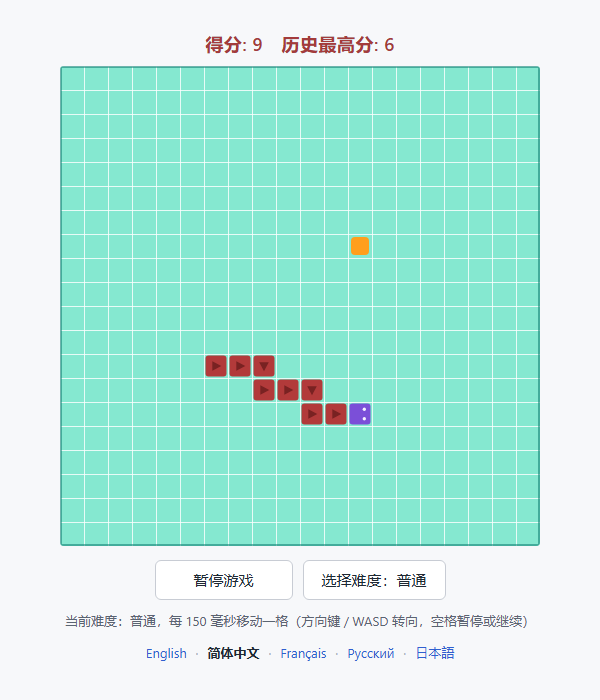

# Snake-game Skill

[English](README.md) · **简体中文** · [Français](README.fr.md) · [Русский](README.ru.md) · [日本語](README.ja.md)

一个可开源的 Agent Skill：让 AI 交付一个**打开就能玩**的贪吃蛇网页游戏。



## 马上开玩
**手机、电脑都能直接打开这个网址：**

> 🎮 **https://wohui-netizen.github.io/wohui-Snake-game/skills/snake-game/assets/snake-game.html**
>
> 文档站（点语言就地切换）：https://wohui-netizen.github.io/wohui-Snake-game/

打开后点「Start Game」。手机上可以滑动转向、轻点暂停，也可以直接点两个按钮下方那排方向键（▲ ◀ ▼ ▶）。


不用安装、不用 AI、不用构建：游戏就是本仓库里的**一个文件**。

1. 打开 **[`skills/snake-game/assets/snake-game.html`](skills/snake-game/assets/snake-game.html)**，点右上角 **Download raw file** 下载（或者直接克隆仓库）。
2. **双击下载到的文件**，浏览器就会打开它，断网也能玩。
3. 点 **「Start Game」**（切到中文界面后是「开始游戏」）：

| 操作 | 作用 |
| --- | --- |
| `←` `↑` `→` `↓` 或 `W` `A` `S` `D` | 控制蛇的方向（未开局时按方向键直接开始） |
| `空格` | 暂停 / 继续 |
| `Difficulty: Normal` 按钮（中文界面为「选择难度：普通」） | 循环切换 简单 → 普通 → 困难 → 地狱，越右越快 |
| 按钮下面那行语言 | 在 English / 简体中文 / Français / Русский / 日本語 之间切换界面 |

吃橙色方块、别撞墙也别撞到自己，试着把整个棋盘填满；历史最高分会记住。

想用网址打开也行：

```bash
cd skills/snake-game/assets
python -m http.server 8000
# 浏览器打开 http://localhost:8000/snake-game.html
```


## 1. 项目解决什么问题

想要一个「双击就能玩」的贪吃蛇网页，从零写要同时处理一堆容易翻车的细节：计时循环与难度速度、撞墙／撞自己／填满棋盘三种终局、快速连按方向键丢输入、切走标签页再回来蛇直接暴走撞墙、最高分持久化、移动端操作、以及外链资源导致断网打不开。让 AI 每次从零生成，结果往往看起来能跑、实际有坑。

本项目把一份**已经跑通并被自动化测试覆盖**的完整实现固化成技能资产，把交付规格和验收清单写进 `SKILL.md`：AI 不再从零写，而是复制基线、只改用户点名的部分、按清单逐条自检后交付。

- **对使用者**：不用装环境、不用构建，拿到一个 `index.html` 双击即玩；改版只动四个改动点，其余行为不回退。
- **对 AI**：交付标准是「用户能打开并真的玩起来」——规格、终局判定、验收项都写死在技能里，不靠临场发挥。
- **不适用**：网页抓取、PDF、Anki；以及需要后端、联机对战或排行榜的场景（技能会先说明，需另行设计）。

## 2. 主要功能

### 2.1 技能能力

- **固定交付规格**：顶部计分条、中间网格棋盘、下方两个按钮、蛇／食物外观、难度与速度、终局判定、操作方式、状态提示，逐条写进 `SKILL.md` 的规格表。
- **五步工作流程**：定落点 → 复制 `assets/snake-game.html` 为基线 → 只改用户点名项 → 按验收清单自检 → 说明路径、打开方式与本次改动。
- **验收清单**：结构（单文件、无外链、控制台无报错）、功能（吃食物、三类终局、转向、暂停、最高分、窄屏）、视觉三组逐条核对。
- **五个改动点**：`COLORS`（配色）、`DIFFICULTIES`（档位与速度）、`MESSAGES` 与 `LANGUAGES`（界面文案与语言行）、`new SnakeGame(canvas, { cols, rows, cell, difficultyIndex })`（棋盘与默认档位）、输入层（`KEY_DIRECTIONS` 与 `keydown` 处理）。
- **边界**：不做网页抓取／PDF／Anki；不引入框架、打包器与后端。

### 2.2 交付游戏（基线实测特性）

| 分类 | 功能 |
| --- | --- |
| 交付形态 | 单个自包含 HTML 文件，HTML/CSS/JS 全内联，**0 个外部引用**，无构建步骤，断网双击即玩 |
| 棋盘 | 默认 20 × 20 格、每格 24 px（内部 480 × 480，按 `devicePixelRatio` 缩放保证清晰），浅青绿底 + 白色网格线 + 深色外框，窄屏按视口宽度自适应 |
| 计分 | 顶部 `得分: N　历史最高分: M` 实时更新；最高分在游戏结束时写入 `localStorage`（键 `snake-game:best-score`），刷新后保留；存储被禁用时降级为不崩溃 |
| 难度 | 4 档，难度越高越快：简单 220、普通 150、困难 100、地狱 60 毫秒／格，默认「普通」，游戏中切换立即生效并在提示行显示当前速度 |
| 语言 | 界面内置 **英文（默认）**、简体中文、Français、Русский、日本語 五种语言；点按钮下方那一行即可整页即时切换，选择写入 `localStorage`（键 `snake-game:language`），刷新后保留，遇到不认识的语言代码回退英文 |
| 终局 | 蛇头撞墙判负、撞到自己判负（覆盖层给出原因与最终得分）、蛇填满全部格子判通关且不再生成食物 |
| 转向 | 最多缓冲 2 次转向（快速连按不丢输入）、禁止 180° 反向掉头、贴着蛇尾的格子在被让出时可正常进入 |
| 操作 | 方向键／WASD 转向，空格暂停／继续，未开局时按方向键直接开始；移动端滑动转向、轻点暂停，并在按钮下方显示屏幕方向键；焦点在按钮上时不会误触发暂停 |
| 稳定性 | 每帧最多补 4 步，切走标签页再回来不会瞬间连走几十格撞墙 |
| 无障碍 | 状态行 `role="status" aria-live="polite"` 播报、按钮可键盘聚焦、画布带 `aria-label` |
| 调试钩子 | `window.snakeGame`（当前实例）、`window.SnakeGame`（类）、`window.SNAKE_DIFFICULTIES`（档位表）、`window.SNAKE_LANGUAGES`（语言表） |

## 3. 安装方法

**前置要求：无。** 技能本体是纯文本 + 一个 HTML 文件；游玩只需要现代浏览器（Chrome / Edge / Firefox / Safari）。可选：任意 Python 3，用于起本地静态服务。

### 方式 A：安装为 Agent 技能

1. 把整个技能目录复制到你所用 Agent 的技能目录下：

   ```bash
   # 目标目录以宿主文档为准，例如 Codex 风格的工具读取 skills 目录下的技能包
   cp -r skills/snake-game <你的技能目录>/snake-game
   ```

2. 重新加载（或重启）宿主，让它发现新技能。
3. 显式调用，或直接用自然语言描述需求让技能自动触发：

   ```text
   $snake-game 生成一个可以直接打开的贪吃蛇网页游戏
   ```

### 方式 B：不安装，直接用

技能目录里的基线文件本身就是完整游戏，复制或直接打开都能玩：

```bash
skills/snake-game/assets/snake-game.html
```

### 方式 C：手动接入任意 AI

把 `SKILL.md` 当作指令、`assets/snake-game.html` 当作模板交给模型即可，不依赖特定宿主。

### 可选：校验安装是否完整

技能包遵循 Agent Skill 规范，可用官方 skill-creator 的校验脚本自检（脚本需自备）：

```bash
python -X utf8 quick_validate.py skills/snake-game
# 期望输出：Skill is valid!
```

目录应包含：`SKILL.md`、`agents/openai.yaml`、`assets/snake-game.html`，且没有多余的 `scripts/`。

## 4. 使用方法

### 4.1 让技能生成或改版

```text
$snake-game 生成一个可以直接打开的贪吃蛇网页游戏
帮我调整贪吃蛇：16×16 棋盘，难度分 3 档，做成暗色主题
霓虹配色，格子大一点，难度来 5 档，按 P 暂停
```

技能只改你点名的部分，其余保持基线行为；交付时会给出文件路径、打开方式、玩法与本次改动。

### 4.2 直接玩基线

```bash
# 方式一：双击打开，无需任何环境
skills/snake-game/assets/snake-game.html

# 方式二：起一个本地静态服务
cd skills/snake-game/assets
python -m http.server 8000
# 浏览器打开 http://localhost:8000/snake-game.html
```

玩法：点 `开始游戏` 后，用 **方向键 / WASD** 转向，**空格** 暂停或继续，点 `选择难度：普通` 循环切换档位（也可以开局后随时切）。界面默认英文，点按钮下方的语言行可在 English / 简体中文 / Français / Русский / 日本語 之间即时切换，选择会被记住。

### 4.3 想改什么，改哪里

| 想改的东西 | 改动位置 |
| --- | --- |
| 棋盘格数与单格像素 | `new SnakeGame(canvas, { cols, rows, cell, difficultyIndex })`（画布尺寸运行时按格数重算，无需手改 HTML 的 `width`/`height`） |
| 难度档位、速度、档位名称 | `DIFFICULTIES` 数组，`stepMs` 越小越快；增删档位后按钮自动循环 |
| 配色 | `COLORS`（棋盘、网格线、外框、食物、蛇身、蛇头、箭头、眼睛） |
| 界面文案、增删语言 | `MESSAGES`（各语言文案）与 `LANGUAGES`（语言行）；新增一门语言＝两边各加一条 |
| 方向键映射、暂停键 | `KEY_DIRECTIONS` 与 `keydown` 处理 |

### 4.4 在浏览器控制台调试

```js
snakeGame.setDifficulty('insane'); // 切到最快档（也可传档位序号）
snakeGame.setLanguage('ja');       // 切换界面语言
snakeGame.tick();                  // 手动走一步
snakeGame.snapshot();              // 查看状态、得分、蛇身坐标、当前速度
snakeGame.render();                // 重绘当前局面
snakeGame.start();                 // 重开一局
```

## 5. 输入输出示例

| # | 用户输入 | 技能输出 |
| --- | --- | --- |
| 1 | 「做个贪吃蛇，打开就能玩」 | 把基线复制为 `index.html`，规格一字不改，附带打开方式与玩法说明 |
| 2 | 「16×16 棋盘，难度分 3 档，做成暗色主题」（英文描述同样适用） | 同一页面改为 16 行 16 列、3 档速度（200 / 120 / 70 毫秒）、深色底 + 青绿蛇身，其余行为不变 |
| 3 | 「霓虹配色，格子大一点，难度来 5 档，按 P 暂停」 | 12×12 大格棋盘、5 档难度、霓虹配色，暂停键改为 P（空格仍可用），提示行文案同步更新 |
| 4 | 「把难度改成下拉框，再加个重新开始按钮」 | 在基线上替换难度控件与按钮，规格其余部分保持不变 |
| 5 | 「帮我抓取某网页数据 / 生成一份 PDF / 做一套 Anki 卡」 | 说明不在本技能范围内，不产出游戏页面 |

第 1 类请求的典型产出：

```text
index.html        # 单个自包含文件，双击即可游玩（约 830 行，0 个外部依赖）
```

```text
已生成 index.html（20×20 棋盘，默认难度「普通」）。
打开方式：直接双击；或在本目录运行 python -m http.server 8000 后访问 http://localhost:8000/
玩法：方向键 / WASD 转向，空格暂停，点「选择难度」切换档位（简单 220 → 地狱 60 毫秒每格）。
本次未改动任何规格，与基线一致。
```

第 2、3 类请求只会落在上面「想改什么，改哪里」的五个改动点上，改完再逐条过一遍验收清单。

## 目录结构

```text
README.md                  # 本文件（英文，默认）
README.zh-CN.md            # 简体中文
README.fr.md               # Français
README.ru.md               # Русский
README.ja.md               # 日本語
index.html                 # 单页文档：点一下语言即时整页切换
LICENSE                    # MIT 许可证
skills/snake-game/
├── SKILL.md               # 英文：交付规格、工作流程、验收清单、边界
├── SKILL.zh-CN.md         # 简体中文
├── SKILL.fr.md            # Français
├── SKILL.ru.md            # Русский
├── SKILL.ja.md            # 日本語
├── agents/openai.yaml     # UI 元数据：display_name / short_description / default_prompt
└── assets/snake-game.html # 完整可运行的基线游戏（831 行：渲染、计分、难度、五种语言、暂停、移动端、无障碍）
docs/preview.png           # 英文界面预览图（真实浏览器渲染）
docs/preview.zh-CN.png     # 中文界面预览图
```

技能目录内没有 `scripts/`：这个任务不需要脚本，基线 HTML 本身就是可复制的交付模板。

## 验证情况

- `SKILL.md` 与 `agents/openai.yaml` 通过官方 skill-creator 的 `quick_validate.py`（输出 `Skill is valid!`），并通过更严格的结构校验：主文件行数／字符预算、引用路径存在性、元数据字段、空目录检查全部 0 错误。
- 游戏逻辑在真实 Chromium 内核（无头 Edge）跑 24 项断言，另用 Node + DOM 桩跑 87 项断言，覆盖：移动与吃食物、撞墙判负、撞到自己判负、填满棋盘通关、难度与速度映射、禁反向、转向缓冲、暂停与继续、最高分持久化与存储不可用降级、长卡顿不补步、画布绘制内容与配色。
- `index.html` 单页文档同样在无头浏览器里跑了 22 项断言：默认英文，点一下即整页就地切换（不跳转），地址栏 hash 同步更新，选择被记住并与游戏共用。
- 语言层同样覆盖：默认为英文，五种语言各自渲染自己的文案，切换即时生效，刷新后保留选择，存储里是不认识的语言代码时回退英文。
- 上表第 1、2、3 类请求都实际生成过页面并逐项复测，全部通过；预览图即真实浏览器渲染结果。
- 未验证项：`localStorage` 在 `file://` 下的表现随浏览器而异（代码已做降级，不会报错）。

## 许可证

本项目采用 [MIT License](LICENSE)：可自由使用、修改、分发与商用，只需保留版权与许可声明。

```text
Copyright (c) 2026 Snake-game Skill contributors
```

想署自己的名字，改 `LICENSE` 里的这一行即可。
